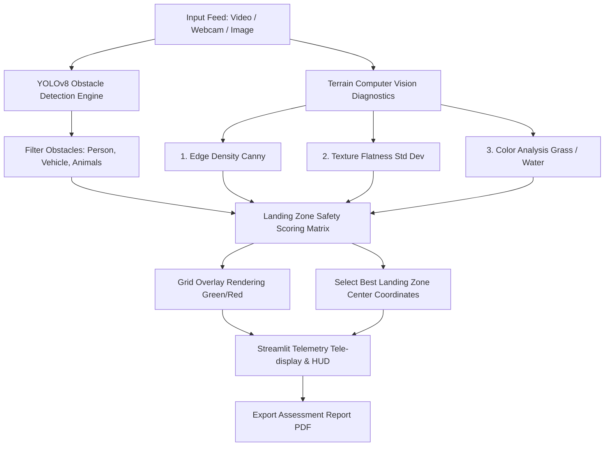

# SafeLand AI – Autonomous Drone Landing Zone Detection

SafeLand AI is an AI-powered system designed to analyze aerial drone video feeds, live camera streams, or orthophoto imagery in real time to automatically detect and score the safest landing zones. The system uses YOLOv8 object detection to locate obstacles (people, cars, trees, animals) and runs computerized terrain diagnostics (edge density, texture variance, color spectrum analysis) to evaluate the landing surface.

---

## 🚀 Key Features

* **Multi-Mode Input:** Supports uploading drone flight videos (`.mp4`, `.avi`, `.mov`), live system webcam feeds, or static image calibration files.
* **YOLOv8 Obstacle Detection:** Locates persons, vehicles, animals, and caution objects, dynamically applying risk classification (`DANGEROUS` vs `CAUTION`).
* **Computerized Terrain Analysis:** Calculates ground surface roughness using texture standard deviation (flatness) and Canny edge density (complexity).
* **Color Indexing:** Scans the HSV spectrum to detect grass surfaces (optimal landing zones) and blue water bodies (prohibited zones).
* **Real-time Tactical Overlay HUD:** Renders a high-tech head-up-display showing safety score gauges, grid heatmaps, and coordinates of the optimal landing target (Best LZ).
* **PDF Report Exporter:** Outputs high-fidelity, comprehensive PDF reports complete with coordinates, obstacle registers, and terrain metric diagnostics.
* **Modern Dark-Mode Dashboard:** Features a clean, responsive glassmorphic dashboard built using Streamlit.

---

## 🛠️ Tech Stack

* **Language:** Python 3.9+
* **Deep Learning Inference:** Ultralytics YOLOv8 (nano model default, highly scalable)
* **Image Processing:** OpenCV, NumPy, Pillow
* **Interface & Telemetry:** Streamlit
* **Reporting engine:** FPDF2

---

## ⚙️ Installation & Setup

1. **Clone/Navigate to the directory:**
   ```bash
   cd SafeLand-AI
   ```

2. **Create a virtual environment (Recommended):**
   ```bash
   python -m venv venv
   # On Windows:
   venv\Scripts\activate
   # On macOS/Linux:
   source venv/bin/activate
   ```

3. **Install dependencies:**
   ```bash
   pip install -r requirements.txt
   ```

4. **Run the Streamlit Dashboard:**
   ```bash
   streamlit run app.py
   ```

---

## 📐 Architecture & Detection Pipeline



### Safety Scoring Algorithm
For each cell in the $N \times N$ grid, the safety score $S$ (out of 100) is evaluated:

$$S = 100 - P_{\text{obstacle}} - P_{\text{edge}} - P_{\text{texture}} - P_{\text{water}} + B_{\text{green}}$$

* **$P_{\text{obstacle}}$:** Obstacle Penalty. $-100$ for `DANGEROUS` (person, car), $-60$ for `CAUTION` (tree/vegetation).
* **$P_{\text{edge}}$:** Surface Edge Complexity. Penalizes complex terrains with high lines/edges (rocks, structures).
* **$P_{\text{texture}}$:** Grayscale variance std-dev. Penalizes high variance (rough gravel vs flat concrete/grass).
* **$P_{\text{water}}$:** Blue/cyan mask check. $-100$ override if water coverage $> 5\%$.
* **$B_{\text{green}}$:** Vegetation bonus. $+20$ points for green grass presence (only if surface is smooth).

---

## 🗺️ Future Expansion Roadmap

1. **DJI/PX4 Telemetry Integration:** Stream MAVLink telemetry (altitude, heading, GPS coordinates) side-by-side with computer vision to calculate geographic GPS coordinates of the landing point.
2. **LiDAR & Depth Fusion:** Fuse LiDAR point cloud data to determine actual volumetric 3D slopes and physical object heights.
3. **Multispectral/Satellite Imagery:** Scale the pipeline to handle orthomosaic satellite maps for pre-flight path routing and landing hub configurations.
