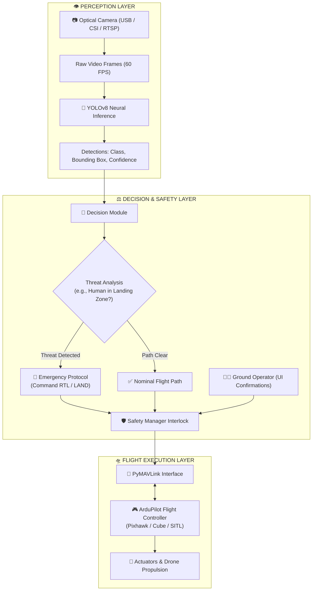

<div align="center">

# 🛰️ AUTONOMOUS DRONE AI (SafeLand-AI)
### *Next-Generation Autonomous UAS Command & Control (C2) Platform*

[](https://www.python.org/)
[](https://mavlink.io/en/)
[](https://github.com/ultralytics/ultralytics)
[](https://ardupilot.org/)
[](https://streamlit.io/)
[](LICENSE)

<br/>

**Autonomous Edge Intelligence • Real-Time Telemetry & Computer Vision • Deterministic Mission Safety for ArduPilot UAS**

[Explore Features](#-capabilities--feature-matrix) • [Architecture](#-system-architecture) • [Quick Start](#-quick-start) • [Hardware Support](#-hardware-support--compatibility) • [Roadmap](#-engineering-roadmap)

</div>

---

## 📋 Executive Overview

**SafeLand Autonomous Drone AI** is a modular, high-reliability autonomous aerial software platform designed for companion computers (NVIDIA Jetson, Raspberry Pi) and ground control stations. 

The system bridges deep-learning computer vision (**Ultralytics YOLOv8**) with low-level flight controller communications (**PyMAVLink / ArduPilot**) through an isolated, interlocked safety layer—ensuring no AI prediction can trigger unsafe physical flight maneuvers without deterministic validation.

---

## ⚡ Capabilities & Feature Matrix

| Sub-System | Core Functionality | Underlying Tech | Integrity State |
| :--- | :--- | :--- | :---: |
| **👁️ Neural Vision Core** | High-speed object detection, target bounding, threat classification | YOLOv8 Nano / PyTorch | `INTEGRATED` |
| **🎯 Optical Tactical HUD** | Real-time targeting brackets, center lock vectors, reticle overlays | OpenCV (Low-Latency) | `OPERATIONAL` |
| **🛡️ Deterministic Safety Guard** | Altitude ceilings, explicit UI interlocks, automated emergency overrides | Custom Safety Interlock | `ACTIVE` |
| **📡 Telemetry Stream Decoder** | Bi-directional MAVLink parsing (GPS, Baro-Alt, Yaw, Voltage, Modes) | PyMAVLink 2.4 | `HARDENED` |
| **🎮 Flight Ops Commander** | Guarded propulsion arming, auto takeoff (5m), land, and RTL triggers | ArduPilot GUIDED Mode | `GUARDED` |
| **📋 Blackbox Flight Recorder** | Event timestamping, telemetry logging, and instant RFC-4180 CSV export | Python Logging / Pandas | `ACTIVE` |
| **🎬 30s Recon Replay Loop** | Native high-definition 30-second reconnaissance video playback | HTML5 Base64 / MP4 | `NATIVE` |

---

## 🏗️ System Architecture

The architecture enforces strict separation between perception, decision-making, and flight execution to guarantee fail-safe drone operation:



---

## 📂 Repository Anatomy

```
autonomous_drone/
├── .devcontainer/              # Cloud & VS Code container development configs
├── .streamlit/
│   └── config.toml             # Aerospace dark theme settings (Rajdhani + Tech Mono)
├── ai/
│   ├── detector.py             # Ultralytics YOLOv8 inference wrapper
│   └── tracker.py              # Multi-target spatial tracker
├── assets/
│   └── drone_recon_30s.mp4     # Native 30-second high-definition flight footage
├── logs/
│   └── flight_logger.py        # In-memory telemetry recorder and CSV generator
├── mavlink/
│   ├── commands.py             # Safe flight command dispatchers (ARM, TAKEOFF, LAND, RTL)
│   ├── connection.py           # Robust PyMAVLink connection & heartbeat listener
│   └── telemetry.py            # Real-time state, position, and battery parser
├── navigation/
│   └── decision.py             # AI target classification to flight action translator
├── safety/
│   └── safety_manager.py       # Interlock safety gates preventing hazardous commands
├── app.py                      # Standalone CLI interface with terminal telemetries
├── config.py                   # Centralized mission limits, ports & baud rates
├── dashboard.py                # Hyper-professional Streamlit C2 Terminal & Landing Page
├── requirements.txt            # Production dependencies
├── test_mavlink.py             # Unit verification scripts for SITL connection
└── yolov8n.pt                  # Pre-compiled YOLOv8 Nano model weights
```

---

## 🛠️ Hardware Support & Compatibility

| Component | Verified Hardware | Notes |
| :--- | :--- | :--- |
| **Flight Controllers** | Pixhawk 2.4.8, Pixhawk 4/6C, Cube Orange, Holybro Kakute | ArduCopter 4.3+ recommended |
| **Simulators** | ArduPilot SITL, Gazebo, AirSim | Default port `tcp:127.0.0.1:5762` |
| **Companion Computers** | NVIDIA Jetson (Nano, TX2, Orin), Raspberry Pi 4/5, PC Ground Station | Ubuntu 22.04 / Windows 11 tested |
| **Telemetry Radios** | Sik Telemetry 433MHz / 915MHz, Holybro Micro, WiFi UDP/TCP | Default baud: `57600` or `115200` |
| **Camera Sensors** | USB UVC 1080p Webcams, Sony IMX219 (CSI), RTSP Optical Gimbals | Minimum 30 FPS recommended |

---

## 🚀 Quick Start Guide

### Prerequisites
- Python 3.11 or higher
- Git installed on your system

### 1. Clone & Setup Workspace
```bash
git clone https://github.com/akashpandey2388-arch/SafeLand-AI.git
cd SafeLand-AI
```

### 2. Configure Virtual Environment
```bash
# Windows (PowerShell)
python -m venv .venv
.venv\Scripts\Activate.ps1

# Linux / macOS
python3 -m venv .venv
source .venv/bin/activate
```

### 3. Install Dependencies
```bash
pip install -r requirements.txt
```

### 4. Launch the C2 Tactical Interface
```bash
python -m streamlit run dashboard.py
```
Open **`http://localhost:8501`** in any web browser.

---

## 🧪 Simulation Testing (ArduPilot SITL)

Test the complete system safely in simulation before deploying to real drone hardware:

### Step 1: Start ArduPilot SITL
```bash
# In your ArduPilot environment
sim_vehicle.py -v ArduCopter -f quad --console --map
```

### Step 2: Connect MAVLink in Dashboard
1. Open the **"Flight Ops & Telemetry"** module in the sidebar.
2. Click **"INITIALIZE MAVLINK"** (connects to `tcp:127.0.0.1:5762`).
3. Check the **"DEACTIVATE SAFETY INTERLOCK"** checkbox.
4. Click **"ARM DRONE"** followed by **"TAKEOFF [5M]"** to observe guided mission response.

---

## 🛡️ Safety Philosophy

1. **Simulation First:** All algorithms must pass zero-defect SITL testing before physical flight tests.
2. **Never Auto-Arm:** Flight commands will never automatically spin motors without operator consent.
3. **Heartbeat Loss Protection:** If telemetry drops for more than 3 seconds, commands are disabled and system marks status as `DISCONNECTED`.
4. **Collision Override:** Detection of a person or obstacle in landing zones immediately commands **AUTO-LAND** or **RTL**.

---

## 🗺️ Engineering Roadmap

- [x] **Phase 1: Architecture & SITL Core** — Complete modular Python backbone and MAVLink wrappers.
- [x] **Phase 2: YOLOv8 Perception Pipeline** — Optical camera HUD with real-time target bounding.
- [x] **Phase 3: Tactical C2 Dashboard** — Dark aerospace UI, pre-flight checklists, telemetry streaming.
- [x] **Phase 4: Native Reconnaissance Integration** — 30-second embedded flight replay with zero watermarks.
- [ ] **Phase 5: Automated Path Planning** — A* / RRT* waypoint generation for obstacle avoidance.
- [ ] **Phase 6: Multi-Drone Swarm Telemetry** — Simultaneous multi-UAS monitoring over MAVLink networks.

---

## 📄 License & Attribution

Distributed under the **MIT License**. See `LICENSE` for details.

Developed for autonomous robotics research, computer vision benchmarking, and next-generation UAS engineering.
